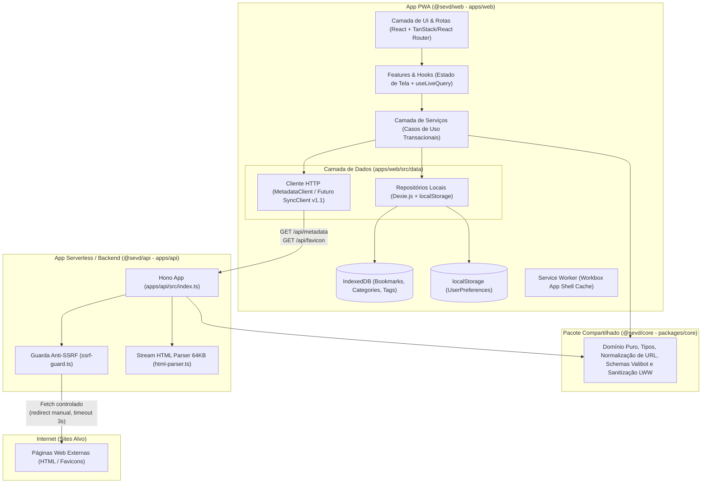
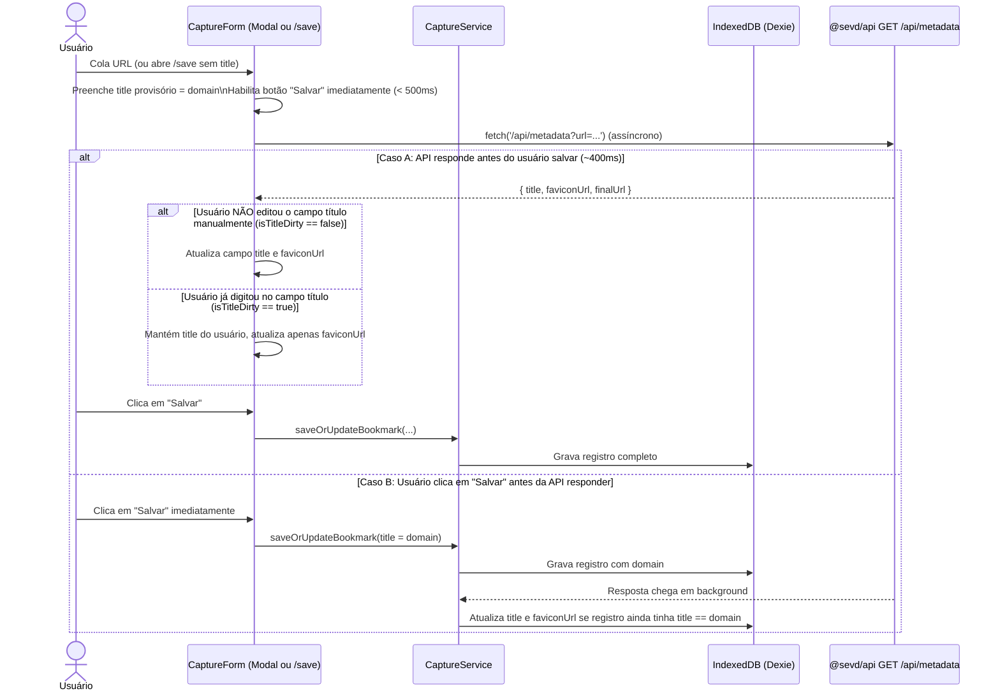

# Documento de Arquitetura e Especificação Técnica — SEVD (Salvar e Ver Depois)

**Versão:** 1.0 (Base para o MVP v1.0 e preparação para v1.1)  
**Documento de Produto Relacionado:** [prd-sevd.md](./prd-sevd.md)  
**Natureza da Arquitetura:** Monorepo `pnpm workspaces` — PWA Local-First (`@sevd/web`) + Domínio Puro (`@sevd/core`) + Borda Serverless Hono (`@sevd/api`)

---

## 1. Visão Arquitetural e Princípios de Engenharia

O **SEVD** adota uma arquitetura **Local-First em Camadas** organizada em um monorepo **`pnpm workspaces`** (`packages/core`, `apps/web`, `apps/api`). No MVP (`v1.0`), o banco de dados oficial reside no navegador do usuário (**IndexedDB** via **Dexie.js**), garantindo latência de leitura/escrita próxima de zero e funcionamento offline completo. As funções serverless em `@sevd/api` atuam exclusivamente como utilitários de rede sem estado para contornar limitações de CORS (extração de metadados) e proteger a privacidade do usuário (proxy de favicons).



### 1.1 Princípios Inegociáveis
1. **Local-First real:** Nenhuma operação de salvar, editar, excluir, buscar ou filtrar depende de resposta da rede. A rede apenas enriquece dados (título e favicon) de forma assíncrona e não-bloqueante.
2. **Isolamento físico do Domínio Puro (`@sevd/core`):** `packages/core` contém apenas funções puras, tipos TypeScript e schemas de dados, sem dependências de React, Dexie, DOM ou Hono em seu `package.json`. É consumido via `"@sevd/core": "workspace:*"` tanto por `@sevd/web` quanto por `@sevd/api`.
3. **Fronteiras impostas por pacotes e linter:** Componentes de UI em `@sevd/web` nunca acessam o Dexie ou serviços diretamente; toda mutação passa por um serviço transacional. E `@sevd/web` não mistura dependências de servidor com `@sevd/api`.
4. **Zero requisições diretas do cliente a terceiros:** O navegador só se comunica com a própria origem do app. Favicons externos passam por `/api/favicon` (ou usam avatares locais).
5. **Pronto para Sincronização (`v1.1`):** Todas as entidades usam `UUID v4`, timestamps de modificação (`updatedAt`) atualizados inclusive em cascata e exclusão lógica (`deletedAt`).

---

## 2. Stack Tecnológica e Dependências por Pacote

| Pacote | Tecnologia / Dependência | Papel Técnico | Carregamento |
| :--- | :--- | :--- | :--- |
| **Raiz (Workspace)** | `pnpm`, `typescript`, `vitest`, `eslint` | Orquestração de pacotes (`pnpm-workspace.yaml`), tipagem estrita e execução de testes/lint | Dev/CI |
| **`@sevd/core`** | `valibot` (opcional para schemas) | Regras de negócio puras, tipos, normalização de URL, sanitização e mesclagem LWW | Importado por `web` e `api` |
| **`@sevd/web`** | `vite`, `vite-plugin-pwa`, `react`, `tailwindcss`, `shadcn/ui`, `lucide-react` | App Shell PWA, Service Worker Workbox, componentes acessíveis e lista fixa de 24 ícones | App Shell / Chunks |
| **`@sevd/web`** | `@tanstack/react-router` (ou `react-router`) | Roteamento SPA via History API, *search params* tipados e *code splitting* por rota | App Shell |
| **`@sevd/web`** | `dexie`, `dexie-react-hooks` | Wrapper IndexedDB transacional e queries reativas (`useLiveQuery`) | App Shell |
| **`@sevd/api`** | `hono`, `@hono/vite-dev-server` | Rotas serverless Web Standards (`/api/metadata`, `/api/favicon`) e evolução para `v1.1` | Server-only |
| **Testes (`web`)** | `fake-indexeddb`, `@playwright/test` | Testes de integração transacional dos serviços e testes E2E no navegador | Dev/CI |

---

## 3. Estrutura do Monorepo (`pnpm workspaces`) e Regras de Fronteira

```text
sevd/
├── pnpm-workspace.yaml                 # packages: ['apps/*', 'packages/*']
├── package.json                        # Scripts globais: dev, build, test, lint, typecheck
├── tsconfig.base.json                  # Configuração TypeScript estrita compartilhada
│
├── packages/
│   └── core/                           # @sevd/core — Domínio 100% puro e isomórfico
│       ├── package.json                # Zero dependências de UI, DOM, Dexie ou Hono
│       ├── tsconfig.json
│       ├── src/
│       │   ├── index.ts                # Barrel file exportando domínio e tipos
│       │   ├── types.ts                # Entidades, UserPreferences, BackupPayloadV1, MetadataDTO
│       │   ├── constants.ts            # Limites (200, 280, 50, 20, 5), 8 ColorTokens, 24 CategoryIcons
│       │   ├── url-validator.ts        # Validação de esquema http/https e extração de hostname
│       │   ├── url-normalizer.ts       # Algoritmo de normalização canônica de 6 etapas
│       │   ├── share-extractor.ts      # Extração de primeira URL http(s) e nota de textos compartilhados
│       │   ├── text-search.ts          # Normalização unicode (NFD, sem acentos, lowercase)
│       │   ├── color-hash.ts           # Hash determinístico de string para ColorToken (exceto 'zinc')
│       │   ├── backup-sanitizer.ts     # Estágios 2 e 3 puros de sanitização e mesclagem LWW
│       │   └── backup.schema.ts        # Schema Valibot para validação estrutural de BackupPayloadV1
│       └── tests/                      # Testes unitários puros do domínio (Vitest)
│
└── apps/
    ├── api/                            # @sevd/api — Funções Serverless (v1.0) -> Servidor Full (v1.1)
    │   ├── package.json                # Depende de: "@sevd/core": "workspace:*", "hono"
    │   ├── tsconfig.json
    │   ├── src/
    │   │   ├── index.ts                # Instância principal do Hono exportada (/api/*)
    │   │   ├── routes/
    │   │   │   ├── metadata.ts         # Handler GET /api/metadata
    │   │   │   └── favicon.ts          # Handler GET /api/favicon
    │   │   └── lib/
    │   │       ├── ssrf-guard.ts       # Validação de IP privado/loopback e redirects manuais
    │   │       └── html-parser.ts      # Leitura em stream (64 KB) e extração de <title> e <link>
    │   └── tests/                      # Testes unitários de ssrf-guard, html-parser e rotas Hono
    │
    └── web/                            # @sevd/web — Aplicação Cliente PWA
        ├── package.json                # Depende de: "@sevd/core": "workspace:*"
        ├── index.html                  # Inclui script inline anti-FOUC para aplicação do tema
        ├── vite.config.ts              # Configura Vite + PWA + integração dev com @sevd/api
        ├── functions/
        │   └── api/
        │       └── [[route]].ts        # Adapter fino de deploy serverless reexportando @sevd/api
        ├── src/
        │   ├── data/
        │   │   ├── local/
        │   │   │   ├── db.ts           # Instância Dexie (SevdDatabase) e definição de tabelas
        │   │   │   ├── bookmark.repo.ts
        │   │   │   ├── category.repo.ts
        │   │   │   └── preferences.repo.ts
        │   │   └── remote/
        │   │       └── metadata.client.ts # Cliente fetch com AbortController para /api/metadata
        │   ├── services/               # Casos de uso transacionais (orquestram repos + @sevd/core)
        │   │   ├── capture.service.ts
        │   │   ├── bookmark.service.ts
        │   │   ├── category.service.ts
        │   │   └── backup.service.ts
        │   ├── features/               # Módulos funcionais (Hooks de estado + Containers de rota)
        │   │   ├── capture/            # Formulário único usado em /save e no Modal do Dashboard
        │   │   ├── dashboard/          # Sidebar, barra de busca/filtros, listagem Cards/Compacta
        │   │   ├── categories/         # Tela /categories (CRUD de categorias)
        │   │   └── settings/           # Tela /settings (tema, privacidade, bookmarklet, backup)
        │   ├── ui/                     # Componentes visuais puros (Design System / shadcn)
        │   │   ├── components/         # Button, Dialog, Combobox, TagChips, Toast, FaviconAvatar
        │   │   └── layouts/            # DashboardLayout (Sidebar + Drawer), MinimalCaptureLayout
        │   ├── router.tsx              # Definição de rotas e lazy chunks
        │   └── main.tsx                # Bootstrap da aplicação React
        └── tests/
            ├── integration/            # Testes de services/ com fake-indexeddb (Vitest)
            └── e2e/                    # Testes End-to-End (Playwright)
```

### 3.1 Matriz de Fronteiras de Importação (Isolamento de Workspace + Lint)

| Escopo / Camada | Pode importar de | **PROIBIDO** importar de |
| :--- | :--- | :--- |
| `packages/core/*` (`@sevd/core`) | Apenas arquivos internos de `@sevd/core` e `valibot` | `react`, `dexie`, `hono`, `@sevd/web`, `@sevd/api`, APIs de DOM |
| `apps/api/*` (`@sevd/api`) | `hono`, `@sevd/core` | `react`, `dexie`, `@sevd/web` |
| `apps/web/src/ui/*` | `react`, `lucide-react`, tipos de `@sevd/core` | `dexie`, `apps/web/src/data/*`, `apps/web/src/services/*`, `apps/web/src/features/*`, `@sevd/api` |
| `apps/web/src/data/*` | `dexie`, `@sevd/core` | `react`, `apps/web/src/services/*`, `apps/web/src/features/*`, `apps/web/src/ui/*`, `@sevd/api` |
| `apps/web/src/services/*` | `@sevd/core`, `apps/web/src/data/*` | `react`, `apps/web/src/features/*`, `apps/web/src/ui/*`, `@sevd/api` |
| `apps/web/src/features/*` | `react`, `@sevd/core`, `apps/web/src/services/*`, `apps/web/src/ui/*` | `apps/web/src/data/local/db` (acesso direto às tabelas fora de serviços), `@sevd/api` |

---

## 4. Especificação do Domínio Puro (`packages/core/`)

### 4.1 Contratos e Tipos (`types.ts`)

```typescript
export type ColorToken =
  | 'blue'
  | 'indigo'
  | 'emerald'
  | 'rose'
  | 'amber'
  | 'cyan'
  | 'violet'
  | 'zinc';

export type CategoryIcon =
  | 'Terminal' | 'Folder' | 'Code' | 'Server' | 'Database' | 'BookOpen'
  | 'FileText' | 'Globe' | 'Cpu' | 'Layers' | 'Briefcase' | 'GraduationCap'
  | 'Wrench' | 'Palette' | 'Sparkles' | 'Video' | 'Music' | 'ShoppingBag'
  | 'Shield' | 'Zap' | 'Compass' | 'Bookmark' | 'Archive' | 'Heart';

export interface SyncFields {
  id: string;               // UUID v4 (crypto.randomUUID())
  createdAt: number;        // Epoch ms (Date.now())
  updatedAt: number;        // Epoch ms (atualizado em toda mutação direta ou em cascata)
  deletedAt: number | null; // Epoch ms quando excluído; null quando ativo
}

export interface Bookmark extends SyncFields {
  url: string;               // URL original válida http(s)
  normalizedUrl: string;     // URL canônica gerada por normalizeUrl()
  title: string;             // Máx. 200 chars; fallback = domain
  domain: string;            // Hostname em minúsculas sem 'www.'
  faviconUrl?: string;       // URL absoluta http(s) do ícone (opcional)
  note?: string;             // Máx. 280 chars (opcional)
  categoryId: string | null; // UUID da Category ativa ou null (Inbox)
  tags: string[];            // Array de tags leves (máx. 5 strings de até 20 chars, lowercase, sem '#')
  isFavorite: boolean;
}

export interface Category extends SyncFields {
  name: string;              // Trim, 1..50 chars, único entre ativos (case-insensitive)
  color: ColorToken;         // Padrão na criação rápida: getDeterministicColor(name)
  icon: CategoryIcon;        // Padrão na criação rápida: 'Folder'
}

export interface UserPreferences {
  theme: 'system' | 'light' | 'dark';
  viewMode: 'cards' | 'compact';
  sortBy: 'newest' | 'oldest' | 'alpha';
  fetchMetadata: boolean;             // Padrão: true
  faviconMode: 'proxy' | 'local-only'; // Padrão: 'proxy'
  lastBackupAt: number | null;
}
```

### 4.2 Algoritmo de Normalização de URL (`url-normalizer.ts`)

A função `normalizeUrl(rawUrl: string): string` deve ser determinística e seguir **exatamente** estas 6 etapas em ordem:

1. **Parse e Validação de Esquema:**
   - Faz parse via `new URL(rawUrl.trim())`. Se falhar ou `protocol` não for `'http:'` nem `'https:'`, lança `InvalidUrlError`.
   - Força `url.protocol = 'https:'` (`http` e `https` tornam-se equivalentes).
   - Remove credenciais embutidas (`url.username = ''`, `url.password = ''`).
2. **Normalização de Host e Porta:**
   - `url.hostname` já é convertido para minúsculas pela especificação WHATWG URL.
   - Remove exclusivamente o prefixo `www.` se presente (`url.hostname = url.hostname.replace(/^www\./, '')`). Subdomínios como `www2.` ou `m.` são preservados.
   - Se `url.port === '80'` ou `url.port === '443'`, limpa `url.port = ''`.
3. **Tratamento de Fragmento (`hash`):**
   - Se `url.hash` começar com `#/` ou `#!` (rotas client-side de SPAs externas), **preserva** o `url.hash` intacto.
   - Caso contrário (âncoras de seção como `#heading-1`), define `url.hash = ''`.
4. **Remoção de Parâmetros de Rastreamento (Lista Fechada):**
   - Itera sobre `url.searchParams`. Remove qualquer parâmetro cuja chave (em `toLowerCase()`) corresponda a:
     - Prefixo `utm_` (`key.startsWith('utm_')`)
     - Lista exata: `'fbclid'`, `'gclid'`, `'dclid'`, `'msclkid'`, `'twclid'`, `'igshid'`, `'mc_cid'`, `'mc_eid'`, `'ref'`, `'ref_src'`, `'si'`.
5. **Ordenação Alfabética de Query Params:**
   - Chama `url.searchParams.sort()` (ordena por código UTF-16 das chaves e preserva a ordem/valores relativos).
6. **Remoção de Barra Final (`Trailing Slash`):**
   - Remove barras finais repetidas de `url.pathname` (`url.pathname = url.pathname.replace(/\/+$/, '')`).
   - Na serialização final, se `url.pathname` for `'/'` ou `''`, o resultado **não** termina com `/` antes de `?` ou `#` ou fim da string (ex.: `https://developer.mozilla.org` e `https://developer.mozilla.org/pt-BR/docs`).

### 4.3 Extração de Compartilhamento (`share-extractor.ts`)

Usada pela rota `/save` ao receber parâmetros do Web Share Target (`url`, `text`, `title`):
1. Se o parâmetro `url` contiver uma URL `http(s)` válida, usa `url` como link capturado e `text` (truncado em 280 caracteres) como sugestão de `note`.
2. Se `url` estiver vazio, aplica a regex `/https?:\/\/[^\s<>"')]+/i` sobre `text`:
   - A **primeira correspondência** (limpando pontuação final solta como `.`, `,`, `;`, `)`) vira a URL capturada.
   - O restante de `text` (removendo a URL extraída, fazendo `trim()` e colapsando espaços múltiplos) vira a sugestão de `note` (truncada em 280 caracteres).

---

## 5. Persistência Local e Casos de Uso Transacionais (`@sevd/web`)

### 5.1 Configuração do Dexie (`apps/web/src/data/local/db.ts`)

Não são utilizados índices únicos físicos (`&`) no IndexedDB para permitir que múltiplos registros ou lápides de *soft delete* coexistam sem disparar `ConstraintError` em renomeações ou importações.

```typescript
import Dexie, { type Table } from 'dexie';
import type { Bookmark, Category, Tag } from '@sevd/core';

export class SevdDatabase extends Dexie {
  bookmarks!: Table<Bookmark, string>;
  categories!: Table<Category, string>;

  constructor() {
    super('sevd_db');
    this.version(1).stores({
      bookmarks: 'id, normalizedUrl, domain, categoryId, *tags, createdAt, updatedAt',
      categories: 'id, name, updatedAt',
    });
  }
}
```

### 5.2 Regras Transacionais de Negócio (`apps/web/src/services/`)

Todas as escritas que envolvem checagem de unicidade, ressurreição de lápide ou efeito cascata rodam dentro de `db.transaction('rw', [...tables], async () => { ... })`:

#### A. Salvar ou Atualizar Link (`capture.service.ts`)
1. Calcula `normalizedUrl = normalizeUrl(input.url)` e `domain = extractDomain(input.url)`.
2. Busca registros em `db.bookmarks.where('normalizedUrl').equals(normalizedUrl).toArray()`.
3. **Caso 1 — Existe registro ativo (`deletedAt === null`):**
   - Atualiza o registro existente mantendo o `id` e o `createdAt` originais, aplicando os novos `title`, `note`, `categoryId`, `tags`, `isFavorite`, `faviconUrl` e definindo `updatedAt = Date.now()`.
4. **Caso 2 — Existe apenas lápide (`deletedAt !== null`):**
   - **Ressurreição começando do zero:** reaproveita o `id` da lápide mais recente (e remove fisicamente eventuais lápides duplicadas extras para a mesma `normalizedUrl`), define `deletedAt = null`, **reinicia `createdAt = now` e `updatedAt = now`**, e grava apenas os dados do novo formulário (descartando notas, tags, categoria e favorito antigos).
5. **Caso 3 — Nenhum registro encontrado:**
   - Cria novo registro com `id = crypto.randomUUID()`, `createdAt = now`, `updatedAt = now`, `deletedAt = null`.
6. **Pós-primeira gravação:** dispara `ensurePersistentStorage()` (RF-19) se ainda não verificado.

#### B. Criar, Renomear e Excluir Categorias (`category.service.ts`)
1. **Unicidade em ativos:** compara nomes normalizados (`name.trim().toLowerCase()`). Se já existir registro **ativo** (`deletedAt === null`) com o mesmo nome, rejeita com `DuplicateNameError`.
2. **Ressurreição na criação:** se existir uma lápide (`deletedAt !== null`) com o mesmo nome (case-insensitive), reaproveita o `id` da lápide, limpa `deletedAt = null`, reinicia `createdAt = now` e `updatedAt = now`, e redefine cor/ícone para os padrões do novo cadastro.
3. **Renomeação com colisão em lápide:** se o usuário renomear a Categoria ativa `A` para um nome que já está ocupado por uma lápide excluída `B` (`deletedAt !== null`), a transação **deleta fisicamente** a lápide `B` (`table.delete(B.id)`) antes de atualizar `A.name` e `A.updatedAt = now`.
4. **Exclusão com Efeito Cascata em `updatedAt` (RF-15):**
   - Ao excluir uma Categoria (`catId`):
     ```typescript
     await db.transaction('rw', [db.categories, db.bookmarks], async () => {
       const now = Date.now();
       await db.categories.update(catId, { deletedAt: now, updatedAt: now });
       await db.bookmarks
         .where('categoryId')
         .equals(catId)
         .modify((bookmark) => {
           if (bookmark.deletedAt === null) {
             bookmark.categoryId = null;
             bookmark.updatedAt = now; // Essencial para mesclagem (RF-18) e sync (v1.1)
           }
         });
     });
     ```
   - *Nota sobre Tags:* Tags não possuem tabela ou tela de gestão. Para sugestões no input de tags, o app consulta os valores únicos já cadastrados nos links ativos via `db.bookmarks.orderBy('tags').uniqueKeys()`.

#### C. Pipeline de Importação em 4 Estágios (`backup.service.ts` + `backup-sanitizer.ts`)

```typescript
export interface BackupPayloadV1 {
  version: 1;
  exportedAt: number;
  bookmarks: Bookmark[];
  categories: Category[];
}
```

1. **Estágio 1 — Validação Estrutural (Valibot):** verifica tipos primitivos, `version === 1` e presença dos arrays `bookmarks` e `categories`. Falha estrutural aborta a importação antes de tocar no banco.
2. **Estágio 2 — Sanitização Pura (com relatório):**
   - Descarta links com URL inválida ou esquema diferente de `http(s)` (incrementando `invalidUrlsDropped`).
   - Recalcula `normalizedUrl` e `domain` de todos os links com a regra vigente.
   - Trunca `Bookmark.title` (200 chars), `Bookmark.note` (280 chars), `Category.name` (50 chars) e normaliza `Bookmark.tags` (máx. 5 tags de até 20 chars, lowercase, sem '#'), contabilizando os ajustes no relatório.
   - Normaliza `ColorToken` e `CategoryIcon` desconhecidos para os padrões (`'zinc'` / `'Folder'`).
3. **Estágio 3 — Mesclagem Transacional (*Last-Write-Wins* por `updatedAt`):**
   - **Casamento e Remapeamento de Categorias:**
     - Se uma categoria importada tiver o mesmo `name` (case-insensitive) de uma categoria local mas `id` diferente, mantém o `id` local e registra no mapa `categoryIdRemap.set(imported.id, local.id)`, aplicando a regra de vencedor por `updatedAt >= local.updatedAt` para os demais campos (`color`, `icon`, `deletedAt`).
   - **Casamento de Bookmarks:**
     - Casa por `id` ou por `normalizedUrl`. O registro com maior `updatedAt` vence (inclusive se o vencedor for uma lápide com `deletedAt !== null`).
   - **Limpeza de Referências Órfãs pós-mesclagem:**
     - Após consolidar o estado final de `categories`, qualquer bookmark cujo `categoryId` aponte para uma categoria inexistente ou com `deletedAt !== null` tem `categoryId` ajustado para `null` (Inbox). Tags permanecem com os valores do bookmark vencedor.

---

## 6. Roteamento, Estado de URL e Fluxos de Captura

### 6.1 Árvore de Rotas (History API)

| Rota | Chunk / Carregamento | Layout | Papel |
| :--- | :--- | :--- | :--- |
| `/` | Chunk `dashboard` | `DashboardLayout` | Listagem principal, filtros por URL, Modal de Captura Interna (RF-03) e Edição (RF-14) |
| `/save` | Chunk `capture` (**Crítico < 500 ms**) | `MinimalCaptureLayout` | Captura externa exclusiva para **Bookmarklet** (`window.open`) e **Web Share Target** |
| `/categories` | Chunk `categories` | `DashboardLayout` | CRUD de Categorias com busca local e contagem de links |
| `/settings` | Chunk `settings` (+ `valibot` lazy) | `DashboardLayout` | Preferências, instalação, bookmarklet e Importar/Exportar backup |

### 6.2 Contrato de *Search Params*

1. **No Dashboard (`/`):**
   - `?q=<string>`: texto de busca livre (atualizado via `replace: true` para não poluir o histórico a cada tecla).
   - `?view=inbox | favorites`: filtro de visão especial (atualizado via `replace: false` / `push`).
   - `?cat=<categoryId>`: filtro por categoria específica (mutuamente exclusivo com `view`; se ambos vierem na URL, `view` vence e `cat` é limpo).
   - `?tags=<tag1>,<tag2>`: filtro cumulativo (**AND**) por uma ou mais tags (strings).
2. **Na Captura Externa (`/save`):**
   - `?url=<string>&title=<string>&text=<string>&icon=<string>&source=bookmarklet | share`

### 6.3 Código do Bookmarklet (RF-02)

Gerado dinamicamente em `/settings` usando `window.location.origin`:

```javascript
javascript:(() => {
  const o = 'https://SEU_DOMINIO_AQUI';
  const u = encodeURIComponent(location.href);
  const t = encodeURIComponent(document.title || '');
  const s = encodeURIComponent((window.getSelection ? window.getSelection().toString() : '').slice(0, 280));
  const el = document.querySelector('link[rel~="icon"], link[rel="apple-touch-icon"]');
  const ic = encodeURIComponent(el && el.href ? el.href : '');
  const w = 440, h = 580;
  const l = Math.max(0, (screen.width - w) / 2);
  const tp = Math.max(0, (screen.height - h) / 2);
  window.open(
    `${o}/save?url=${u}&title=${t}&text=${s}&icon=${ic}&source=bookmarklet`,
    'sevd_capture',
    `width=${w},height=${h},left=${l},top=${tp},noopener=0`
  );
})();
```

---

## 7. Especificação Técnica das Funções Serverless (`apps/api` — `@sevd/api`)

### 7.1 Integração `@sevd/api` (Hono) no Vite e na Borda

- **Em `apps/api/src/index.ts`:** exporta a instância `app = new Hono().basePath('/api')` com as rotas `/metadata` e `/favicon`.
- **No desenvolvimento local (`pnpm dev`):**
  - **Modo integrado:** em `apps/web/vite.config.ts`, o plugin `@hono/vite-dev-server` aponta para `@sevd/api` com `exclude: [/^(?!\/api\/).*/]`, interceptando apenas `/api/*` dentro do Vite.
  - **Modo processos paralelos (alternativo):** `apps/api` roda em porta própria e `apps/web/vite.config.ts` configura `server.proxy: { '/api': 'http://localhost:3001' }`.
- **Em `apps/web/functions/api/[[route]].ts` (Deploy unificado Cloudflare Pages):**
  ```typescript
  import { handle } from 'hono/cloudflare-pages';
  import { app } from '@sevd/api';
  export const onRequest = handle(app);
  ```

### 7.2 Concorrência entre UI e `GET /api/metadata`



### 7.3 Regras do Guarda Anti-SSRF (`apps/api/src/lib/ssrf-guard.ts`)

1. **Validação de esquema e porta:** permite apenas `http:` e `https:` nas portas padrão (`80`, `443` ou omitida).
2. **Blocklist de Hostname e IP:**
   - Rejeita `localhost`, `*.localhost`, `*.local`, `*.internal`, `metadata.google.internal`.
   - Se o hostname for um literal IPv4 ou IPv6, rejeita faixas privadas/reservadas:
     - `0.0.0.0/8`, `10.0.0.0/8`, `100.64.0.0/10`, `127.0.0.0/8`, `169.254.0.0/16`, `172.16.0.0/12`, `192.168.0.0/16`
     - `::1`, `fc00::/7`, `fe80::/10`, `::ffff:0:0/96` (IPv4-mapped IPv6).
3. **Loop de Redirecionamento Seguro (`safeFetchWithRedirects`):**
   - Executa `fetch(currentUrl, { redirect: 'manual', signal })`.
   - Enquanto o status for `301`, `302`, `303`, `307` ou `308`:
     - Incrementa contador `hops`. Se `hops > maxHops` (5 para `/api/metadata`, 3 para `/api/favicon`), aborta.
     - Resolve `nextUrl = new URL(locationHeader, currentUrl)`.
     - Executa `assertSafeUrl(nextUrl)` antes de realizar o próximo salto.

### 7.4 Stream Parser de 64 KB (`apps/api/src/lib/html-parser.ts`)

1. Valida que o header `Content-Type` da resposta final contém `text/html` ou `application/xhtml+xml`. Caso contrário, cancela o body imediatamente (`await response.body?.cancel()`).
2. Lê do `response.body.getReader()` usando `TextDecoder('utf-8', { fatal: false })` até acumular **65.536 bytes (64 KB)** ou encontrar a substring `</head>` (case-insensitive), chamando `reader.cancel()` em seguida.
3. Extrai os metadados aplicando precedência:
   - `title`: `meta[property="og:title"]` → `meta[name="twitter:title"]` → `<title>`.
   - `faviconUrl`: `link[rel="icon"]` → `link[rel="shortcut icon"]` → `link[rel="apple-touch-icon"]` → `new URL('/favicon.ico', finalUrl).href`.

### 7.5 Proxy de Favicon (`GET /api/favicon`)

1. Valida requisição com `ssrf-guard` (timeout de `2000 ms`, máx. 3 redirects).
2. Verifica se `Content-Type` começa com `image/` (ou `application/octet-stream` quando a URL termina em `.ico`).
3. Lê o stream da imagem com teto estrito de **262.144 bytes (256 KB)**. Se exceder, aborta e retorna `404`.
4. Responde com os bytes da imagem e os cabeçalhos obrigatórios de segurança e cache:
   ```http
   Content-Type: <image-mime-type>
   Content-Security-Policy: default-src 'none'; style-src 'unsafe-inline'
   X-Content-Type-Options: nosniff
   Cache-Control: public, max-age=604800, s-maxage=2592000, immutable
   ```

---

## 8. PWA, Service Worker e Prevenção de FOUC

### 8.1 Script Inline Anti-Flash de Tema (`apps/web/index.html`)

Executado de forma síncrona no `<head>` antes da renderização do `<body>`:

```html
<script>
  (function () {
    try {
      var raw = localStorage.getItem('sevd_preferences');
      var prefs = raw ? JSON.parse(raw) : null;
      var theme = prefs && prefs.theme ? prefs.theme : 'system';
      var isDark =
        theme === 'dark' ||
        (theme === 'system' && window.matchMedia('(prefers-color-scheme: dark)').matches);
      document.documentElement.classList.toggle('dark', isDark);
    } catch (e) {}
  })();
</script>
```

### 8.2 Configuração do Manifest e Workbox (`apps/web/vite.config.ts`)

- **`manifest.webmanifest`:**
  ```json
  {
    "name": "SEVD — Salvar e Ver Depois",
    "short_name": "SEVD",
    "start_url": "/",
    "display": "standalone",
    "share_target": {
      "action": "/save",
      "method": "GET",
      "params": {
        "title": "title",
        "text": "text",
        "url": "url"
      }
    }
  }
  ```
- **Regras do Workbox (`registerType: 'prompt'`):**
  - `navigateFallback: '/index.html'`
  - `navigateFallbackDenylist: [/^\/api\//]` — **obrigatório** para que chamadas a `/api/metadata` e `/api/favicon` não recebam o HTML do `index.html` quando offline.
  - Como `registerType` é `'prompt'`, uma nova versão do Service Worker nunca recarrega a página sozinha (evitando perder dados preenchidos durante uma captura em andamento — RNF-9). O banner *"Atualização disponível — Recarregar"* só dispara `updateServiceWorker(true)` mediante clique do usuário.

---

## 9. Plano de Transição para a `v1.1` (Servidor Completo de Sincronização e Backup)

O uso de `pnpm workspaces` isola completamente a evolução para servidor completo na `v1.1`, **sem exigir alterações nos componentes de UI em `@sevd/web` nem em `@sevd/core`**:

1. **Manutenção do Modelo Local-First (Modelo 1) em `@sevd/web`:**
   - Os componentes React continuam lendo do Dexie via `useLiveQuery` e gravando via `apps/web/src/services/*`.
2. **Adição do `SyncEngine` em `apps/web/src/data/remote/sync.client.ts`:**
   - Armazena `lastSyncedAt` (cursor retornado pelo servidor) e credenciais/sessão do usuário.
   - **Push de Deltas Locais:** busca no Dexie registros nas tabelas (`bookmarks`, `categories`) onde `updatedAt > lastLocalPushAt` (incluindo lápides com `deletedAt !== null`) e envia em lote para `POST /api/sync/push`.
   - **Pull de Deltas Remotos:** consulta `GET /api/sync/pull?since=<lastSyncedAt>` e aplica os registros recebidos no Dexie usando **a mesma função pura de resolução de conflitos LWW (`updatedAt`) e remapeamento de nomes** já exportada por `@sevd/core` (`backup-sanitizer.ts`).
3. **Evolução Isolada de `@sevd/api` (`apps/api`):**
   - Dependências de banco de dados (ex.: Drizzle/Prisma, driver PostgreSQL/SQLite) e autenticação são instaladas **exclusivamente em `apps/api/package.json`**, mantendo o bundle e a árvore de dependências de `@sevd/web` enxutos.
   - Seja mantendo o **Hono** ou trocando para outro framework de servidor (ex.: Fastify/Express/NestJS) em `apps/api`, `@sevd/core` e `apps/api/src/lib/` (`ssrf-guard.ts`, `html-parser.ts`) são 100% reaproveitados sem reescrita.

---

## 10. Estratégia de Verificação e Testes no Monorepo

1. **Testes Unitários de Domínio (`packages/core/tests/` — `pnpm --filter @sevd/core test`):**
   - `url-normalizer.test.ts`: equivalência `http`/`https`, remoção exclusiva de `www.`, preservação de `#/` e `#!`, remoção da lista fechada de tracking params, ordenação de query params e remoção de barra final na raiz e em paths.
   - `share-extractor.test.ts`: extração de URL embutida no meio de textos compartilhados por apps Android (YouTube, X, navegadores) e geração da sugestão de nota.
   - `backup-sanitizer.test.ts`: resolução de conflitos por `updatedAt`, vitória de lápides mais recentes, casamento de categorias por nome case-insensitive com remapeamento de IDs e limpeza de órfãos.
2. **Testes Unitários da API (`apps/api/tests/` — `pnpm --filter @sevd/api test`):**
   - `ssrf-guard.test.ts` e `html-parser.test.ts`: bloqueio de IPs privados em redirecionamentos encadeados, corte exato em 64 KB e decodificação de `<title>` e `faviconUrl`.
3. **Testes de Integração de Serviços (`apps/web/tests/integration/` — `pnpm --filter @sevd/web test`):**
   - Ressurreição de Bookmark e Categoria excluídos reiniciando `createdAt` e limpando metadados antigos (`fake-indexeddb`).
   - Exclusão de Categoria verificando que todos os links afetados têm seu `updatedAt` atualizado na mesma transação.
   - Renomeação de Categoria para o nome de uma lápide existente verificando a purga física da lápide colidente.
4. **Testes End-to-End (`apps/web/tests/e2e/` — Playwright):**
   - Captura externa via `/save?url=...&source=bookmarklet` e detecção de link `"Já salvo"`.
   - Captura interna via Modal no Dashboard com preenchimento assíncrono de `/api/metadata` e proteção de `isTitleDirty`.
   - Exclusão de link no Dashboard seguida de clique em `[ Desfazer ]` dentro de 5 segundos.
   - Exportação `.json` e reimportação com banner de resumo.
